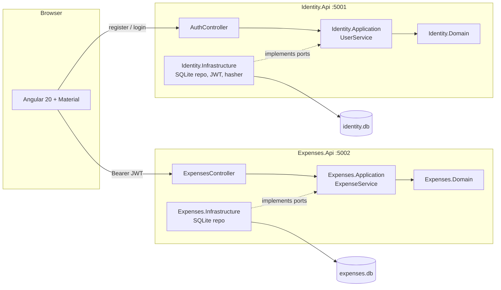

# Expense Tracker: Presentation and Thought Process

Author: Jeffrey
Exercise: .NET Technical Interview Exercise (V5)

This document explains what I built, why I made each decision, and how I worked, including how I used GenAI tools.
Setup instructions are in [README.md](README.md). The GenAI exercise is answered in [GENAI.md](GENAI.md).
Conventions and rules for AI agents are in [AGENTS.md](AGENTS.md).

---

## 1. Reading the exercise

Before writing code I separated the requirements into three groups:

**Hard constraints**
- No Entity Framework, no Dapper, no MediatR. I read this as "show that you understand what an ORM does for you".
  I chose plain ADO.NET with parameterized queries.
- Two APIs: one for the data (CRUD) and one for users (register, login, authorized and public endpoints).
- Business logic independent of the data layer and the API.
- Unit tests for data access, business logic and endpoints. TDD preferred.
- One public repository, no symlinks, `GENAI.md` at the root.

**Quality signals the panel evaluates**
- Clean Architecture, test coverage and TDD, code quality, working functionality with a clean browser console,
  a clear presentation, and fluency plus critical thinking with GenAI tools.

**Decisions left to me**
- The domain, the data store, the frontend framework, the design.

## 2. The user story

> **As a registered user, I want to create, view, edit and delete my expenses so that I can track where my money goes.**

I picked expenses because it is a domain everyone understands in a demo, yet it has real business rules
(money precision, dates, ownership) that justify a separate business layer.

### Acceptance criteria

1. If I am not logged in and open the expenses page, I am sent to the login page.
2. I can register with a valid email and a strong password; I am logged in right away.
3. Registering with an email that already exists shows a clear error.
4. I can create an expense with a description, a positive amount, a category and a date that is not in the future.
5. I can edit and delete my expenses. Delete asks for confirmation.
6. I only see my own expenses. Requesting another user's expense by id returns "not found".
7. The list is sorted by date (newest first), can be filtered by category and date range, is paginated,
   and shows the total for the filtered period.
8. The app works on mobile and desktop.

## 3. Architecture

Key points:

- **Dependencies point inward.** Domain knows nothing. Application defines interfaces (ports) like `IExpenseRepository`.
  Infrastructure implements them with SQL. The API only translates HTTP to application calls and results back to HTTP.
- **Two bounded contexts, two databases.** Identity owns users, Expenses owns expenses. Expenses trusts the JWT and stores
  only the user id from the `sub` claim. They share a small `Shared.Auth` project with the JWT configuration.
- **Patterns with a clear place**: Adapter (repositories and the password/JWT services adapt third-party APIs to
  our ports), Singleton through DI lifetimes for stateless services (never a static instance), Factory for
  connections and for entities that cannot be created invalid. Details in [AGENTS.md, section 10](AGENTS.md#10-design-patterns-and-engineering-principles).
- **Value vs reference types on purpose**: `Money` and typed ids are `readonly record struct`; entities are sealed classes.
- **Async all the way** with cancellation tokens down to the database call, and every ADO.NET object disposed with `await using`.
- **Result pattern instead of exceptions** for expected failures (validation, not found, conflict). The controller maps
  them to HTTP status codes in one place, so the behavior is predictable and easy to test.

## 4. Data storage

| Question | Decision | Reason |
|---|---|---|
| Which store? | SQLite through `Microsoft.Data.Sqlite` | Real relational engine (constraints, indexes, transactions) with zero install for reviewers. |
| How to access it? | ADO.NET: connection, command, parameters, reader | Required by the exercise; it also makes every query visible in review. |
| How to store money? | `INTEGER` cents | Floating point cannot represent 0.10 exactly. Domain uses `decimal`, the repository converts. |
| How to store the expense date? | `TEXT yyyy-MM-dd` | It is a calendar date, not an instant. Avoids the time zone bug where an expense entered at night in Bolivia (UTC-4) moves to the next day. |
| Schema creation? | Versioned SQL scripts applied by a small migrator (`SchemaVersions` table), `STRICT` tables with `CHECK` constraints, seed in Development | One command to run, repeatable schema changes without a framework, the database refuses bad data even if a bug reaches it. |

Schema, diagram, decisions and seed data: [docs/database.md](docs/database.md). API contract: [AGENTS.md, section 9](AGENTS.md#9-data-model).

## 5. Security decisions

- Passwords hashed with ASP.NET Core's `PasswordHasher` (PBKDF2 with salt).
- JWT validated for issuer, audience, lifetime and signature. Short lifetime (60 minutes).
- The user id is always taken from the token, never from the request.
- Another user's expense returns **404 instead of 403**, so ids cannot be probed.
- Generic login error, rate limiting on login and register.
- Errors returned as `ProblemDetails`, never stack traces outside Development.
- CORS limited to the frontend origin.
- Trade-off I accept: the token lives in memory plus `sessionStorage`. An httpOnly cookie would be stronger against XSS,
  but needs CSRF protection and more setup across two APIs. I would switch for a production system.

## 6. How I applied TDD

- For each business rule I wrote the failing test first, ran it, then wrote the minimum code to pass, then refactored.
- The git history shows this: `test(...)` commits followed by `feat(...)` commits. Branches were merged without squash
  on purpose, so the red/green sequence stays visible.
- Test layers:
  - Domain and Application: pure unit tests, repositories mocked with Moq, time controlled with a fake `TimeProvider`.
  - Infrastructure: repositories tested against SQLite in-memory, so the real SQL runs.
  - API: `WebApplicationFactory` tests for status codes, auth (401 without token) and ownership (404).
  - Frontend: stores, API services, guards and interceptors.

<!-- Update at the end: number of tests per project and the dotnet test summary. -->

## 7. Frontend

- Angular 20 with standalone components, Signals and `OnPush` everywhere.
- Clear responsibilities:
  - `services/` are the only classes that use `HttpClient`.
  - `state/` holds signal-based stores (no NgRx; for one feature it would be more ceremony than value).
  - `pages/` are one per route and talk to stores.
  - `components/` are presentational: inputs in, outputs out.
  - `dialogs/` for create/edit and delete confirmation.
  - `interceptors/` attach the token and handle 401 (logout) and server errors.
- Angular Material gives accessible behavior; the visual identity is custom: a "modern ledger" look with warm paper
  background, serif headlines (Fraunces), IBM Plex Sans for text and IBM Plex Mono with tabular numbers for amounts.
- Skeleton loaders that match the real layout, so nothing jumps when data arrives.
- Responsive: ledger table on desktop, card list on mobile, full-screen dialogs on small screens.
- Goal and check: no errors or warnings in the browser console.

## 8. How I used GenAI

The answer to the GenAI exercise (task management API) is in [GENAI.md](GENAI.md). For this project:

- I wrote [AGENTS.md](AGENTS.md) first. It gives any agent the constraints, architecture, conventions and design system,
  so the output stays consistent between sessions. `CLAUDE.md` simply points Claude Code to it.
- I worked in small steps and reviewed each one before continuing. The agent proposes, I decide.
- What I checked in AI output: forbidden libraries sneaking in, SQL built with string interpolation, missing ownership
  filters, `toISOString()` used for calendar dates, tests that pass without testing anything, and generic Material styling.

<!-- Update at the end: two or three concrete examples where I rejected or corrected AI output. -->

## 9. Trade-offs and what I would do with more time

| Area | Current | With more time |
|---|---|---|
| Token storage | Memory + `sessionStorage` | httpOnly cookie with refresh tokens and CSRF protection |
| Categories | Fixed list | User-defined categories (new table) |
| Currency | Single currency | Multi-currency with exchange rates (relevant for USD/BOB) |
| Schema changes | Idempotent initializer | Versioned SQL migrations |
| Observability | Built-in logging | Structured logging, correlation ids, OpenTelemetry |
| Deployment | Local run (Docker optional) | CI pipeline running tests and lint on every PR, container deploy |

## 10. Demo script (about 7 minutes)

1. **Story** (30s): the user story and acceptance criteria.
2. **Architecture** (1.5 min): the diagram, the dependency rule, why two databases.
3. **Code walk** (2 min): one request end to end, from `ExpensesController.Create` to `Expense.Create` to the
   parameterized `INSERT` in `SqliteExpenseRepository`.
4. **Tests** (1 min): run `dotnet test`, show the git history with test-then-feature commits.
5. **App** (2 min): login with the demo user, list with skeletons, filter, create, edit, delete with confirmation,
   mobile view, then show a clean browser console. Show 401 in Swagger without a token.
6. **GenAI** (30s): AGENTS.md and one example where I corrected the AI.

## 11. Demo credentials

`demo@ballastlane.com` / `Demo123!`

Second user, to show that data is isolated: `other@ballastlane.com` / `Demo123!`
