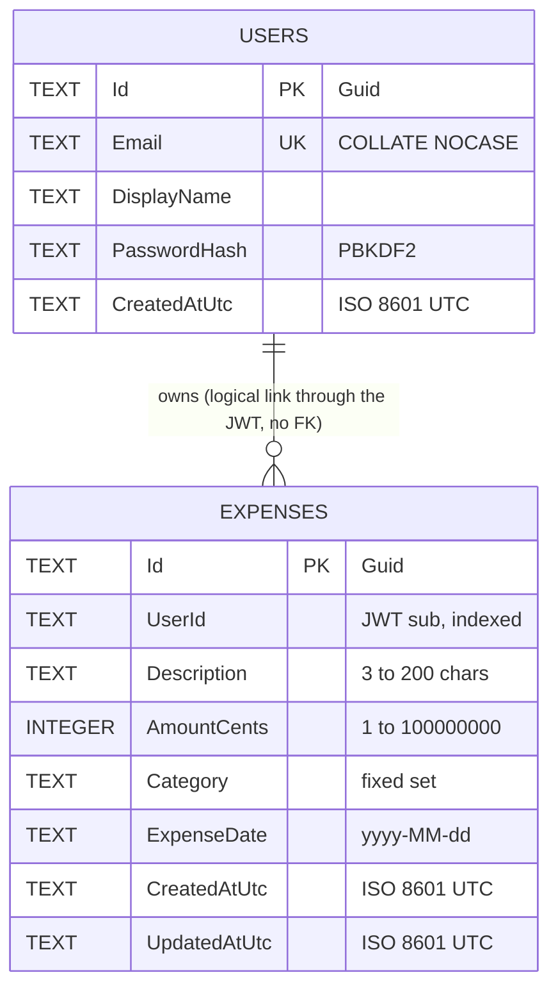

# Database

Two SQLite databases, one per API. Each API owns its data and never reads the other one.

| Database | Owner | Tables | Script |
|---|---|---|---|
| `identity.db` | Identity.Api | `Users`, `SchemaVersions` | [0001_create_users.sql](../src/Identity/Identity.Infrastructure/Persistence/Migrations/0001_create_users.sql) |
| `expenses.db` | Expenses.Api | `Expenses`, `SchemaVersions` | [0001_create_expenses.sql](../src/Expenses/Expenses.Infrastructure/Persistence/Migrations/0001_create_expenses.sql) |

## Diagram



The link between a user and their expenses is logical, not a foreign key: the tables live in different databases.
Expenses.Api trusts the `sub` claim of a validated JWT.

## Design decisions

| Decision | Reason |
|---|---|
| `STRICT` tables | SQLite is dynamically typed by default; `STRICT` rejects, for example, a `REAL` in `AmountCents`. |
| Money as `INTEGER` cents | `REAL` cannot represent 0.10 exactly. The Domain uses `decimal`; the repository converts. |
| `ExpenseDate` as `TEXT yyyy-MM-dd` | It is a calendar date, not an instant. Storing a timestamp would move late-night expenses in UTC-4 to the next day. |
| Ids as `TEXT` Guid (`"D"` format, lower case) | Readable in tools, generated by the application, no round trip to get the id. |
| `CHECK` constraints | Defense in depth. The Domain is the source of truth; the database refuses bad data even if a bug reaches it. |
| `COLLATE NOCASE` on `Email` | `Demo@x.com` and `demo@x.com` are the same account. The Domain also normalizes to lower case. |
| Index `(UserId, ExpenseDate DESC, CreatedAtUtc DESC)` | Matches the main list query, verified with `EXPLAIN QUERY PLAN` (index search, no table scan). |
| No FK between databases | Each service owns its data; SQLite cannot enforce FKs across files anyway. |

## Migrations

A small `SqliteMigrator` in each Infrastructure project runs at startup:

1. Ensures `SchemaVersions (Version INTEGER PK, Name TEXT, AppliedAtUtc TEXT) STRICT` exists.
2. Reads the `.sql` files embedded in the assembly (`Persistence/Migrations/NNNN_name.sql`), ordered by number.
3. Runs each script not yet recorded, inside a transaction, and inserts its row in `SchemaVersions`.
4. Sets `PRAGMA journal_mode = WAL` (persistent per file) for better concurrent reads.

This gives versioned, repeatable schema changes without a migration framework.

## Queries

The SQL lives in one place only: the repositories. This document does not duplicate it, so it cannot drift from the code.

- Users: `src/Identity/Identity.Infrastructure/Persistence/SqliteUserRepository.cs`
- Expenses: `src/Expenses/Expenses.Infrastructure/Persistence/SqliteExpenseRepository.cs`

Rules every query follows:

- Parameterized only (`@id`, `@userId`, ...). No string interpolation or concatenation.
- Every expense query includes `WHERE ... UserId = @userId`. Update and delete with 0 rows affected mean "not found".
- A `UNIQUE` violation on `Users.Email` is translated to a Conflict error.

One example, because it carries the main design trade-off (the list query):

```sql
SELECT Id, UserId, Description, AmountCents, Category, ExpenseDate, CreatedAtUtc, UpdatedAtUtc
FROM Expenses
WHERE UserId = @userId
  AND (@category IS NULL OR Category = @category)
  AND (@from IS NULL OR ExpenseDate >= @from)
  AND (@to IS NULL OR ExpenseDate <= @to)
ORDER BY ExpenseDate DESC, CreatedAtUtc DESC, Id
LIMIT @limit OFFSET @offset;
```

Trade-off: the `(@x IS NULL OR ...)` filter keeps one static, fully parameterized SQL string. For millions of rows
I would build the `WHERE` clause from fixed fragments (still parameterized) so the planner sees a simpler query.

## Seed data (Development, or `Seed:Enabled=true`)

Seeding is done in code (`DatabaseSeeder`), not in SQL, because the password hash must be produced by
`PasswordHasher` and the expense dates are relative to today (through `TimeProvider`). It is idempotent: it only
inserts when the rows do not exist.

| User | Email | Password | Id (fixed, configured in both APIs as `Seed:Users`) | Expenses |
|---|---|---|---|---|
| Demo User | `demo@ballastlane.com` | `Demo123!` | `5d1c0b6e-8f2a-4c3e-9b7d-1a2b3c4d5e6f` | About 30, spread over the last 3 months, all categories |
| Second User | `other@ballastlane.com` | `Demo123!` | `a8f3e2d1-6b4c-4f7a-8e9d-0c1b2a3f4e5d` | 3, used to demonstrate that users cannot see each other's data |

## Verification

The scripts were executed against SQLite 3.37 with a set of valid and invalid inserts (duplicate email with different
case, zero and oversized amounts, `REAL` amount, unknown category, impossible dates such as `2026-02-30` and
`2026-02-29`, dates with time, dates before 2000, whitespace-only description, `UpdatedAtUtc` before `CreatedAtUtc`).
All invalid rows are rejected. The same cases become automated tests in `*.Infrastructure.Tests`.
